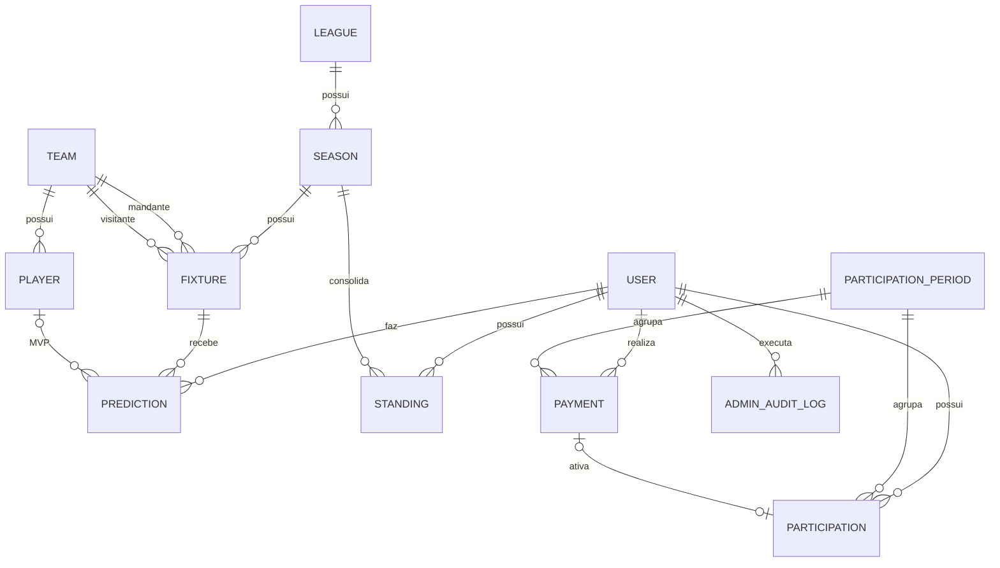

# Modelagem do banco de dados

## Visão geral

O MatchPredict usa PostgreSQL, com Prisma ORM e `prisma-client-js`. A conexão é fornecida por `DATABASE_URL`; em produção, o PostgreSQL é hospedado no Neon.

Esta descrição combina o estado atual de `backend/prisma/schema.prisma` com constraints relevantes criadas pelas migrations. Ela resume o modelo em vez de reproduzir integralmente o schema.

## Enums

| Enum | Valores | Uso |
| --- | --- | --- |
| `Role` | `USER`, `ADMIN` | Papel de acesso da conta |
| `FixtureStatus` | `NS`, `LIVE`, `FT`, `POSTPONED`, `CANCELLED` | Estado local da fixture |
| `WinnerType` | `HOME`, `AWAY`, `DRAW` | Resultado esportivo normalizado |
| `ParticipationPeriodStatus` | `OPEN`, `CLOSED` | Disponibilidade do período mensal |
| `ParticipationStatus` | `ACTIVE`, `CANCELLED` | Elegibilidade mensal do usuário |
| `PaymentMethod` | `PIX` | Método de pagamento implementado |
| `PaymentStatus` | `PENDING`, `PAID`, `EXPIRED`, `CANCELLED`, `FAILED` | Ciclo local da cobrança |
| `AdminAuditAction` | `USER_DELETED`, `USER_DISABLED`, `USER_REACTIVATED` | Ação registrada na auditoria administrativa |

## Diagrama de relacionamentos

`AdminAuditLog.targetId` é texto de auditoria e não uma FK para `User`; isso permite preservar a identificação do alvo após uma exclusão autorizada.

## Contas e auditoria

### User

Tabela física: `users`.

| Campo | Característica |
| --- | --- |
| `id` | UUID, chave primária |
| `name` | Nome da conta |
| `email` | Único |
| `password` | Hash da senha |
| `role` | `Role`, default `USER` |
| `avatarUrl` | Opcional |
| `disabledAt` | Momento da desativação; `null` para conta ativa |
| `authVersion` | Inteiro, default `0`, usado para invalidar JWTs |
| `resetPasswordToken` | Hash opcional e único do token de recuperação |
| `resetPasswordExpiresAt` | Expiração opcional do token |
| `createdAt`, `updatedAt` | Auditoria temporal |

Relações: um usuário possui muitos `Prediction`, `Standing`, `Participation`, `Payment` e registros de `AdminAuditLog` como ator.

Índices relevantes:

- unicidade de `email` e de `resetPasswordToken` quando preenchido;
- índices por `disabledAt`, por `(role, createdAt)` e por `(disabledAt, createdAt)` para consultas administrativas;
- índices GIN com `pg_trgm` em `name` e `email` para busca textual do Admin.

### AdminAuditLog

Tabela física: `admin_audit_logs`.

| Campo | Característica |
| --- | --- |
| `id` | UUID, chave primária |
| `adminUserId` | FK para o administrador que executou a ação |
| `action` | `AdminAuditAction` |
| `targetType` | Tipo textual do alvo, atualmente `USER` |
| `targetId` | Identificador textual do alvo, sem FK |
| `metadata` | JSON opcional com contexto seguro da ação |
| `createdAt` | Data da ação |

A FK `adminUserId` usa `ON DELETE RESTRICT`, preservando a rastreabilidade do ator. Existem índices por `(adminUserId, createdAt)`, `(targetType, targetId)` e `(action, createdAt)`.

## Participação mensal e pagamentos

### ParticipationPeriod

Tabela física: `participation_periods`.

| Campo | Característica |
| --- | --- |
| `id` | UUID, chave primária |
| `referenceYear`, `referenceMonth` | Mês de referência |
| `startsAt`, `endsAt` | Intervalo temporal, com fim exclusivo |
| `participationFeeCents` | Valor do período em centavos |
| `status` | `OPEN` por default |
| `createdAt`, `updatedAt` | Auditoria temporal |

Restrições:

- `(referenceYear, referenceMonth)` é único;
- migration valida mês entre 1 e 12;
- migration exige `participationFeeCents > 0`;
- migration exige `endsAt > startsAt`.

Um período possui muitos pagamentos e muitas participações.

### Participation

Tabela física: `participations`.

| Campo | Característica |
| --- | --- |
| `id` | UUID, chave primária |
| `userId` | FK para `User` |
| `periodId` | FK para `ParticipationPeriod` |
| `paymentId` | FK opcional e única para `Payment` |
| `status` | `ACTIVE` por default |
| `activatedAt` | Momento de ativação |
| `createdAt`, `updatedAt` | Auditoria temporal |

Restrições e índices:

- `(userId, periodId)` é único: uma participação por usuário e período;
- `paymentId` é único quando preenchido: um pagamento ativa no máximo uma participação;
- índices por `(userId, status)`, `periodId` e `(status, createdAt)`.

### Payment

Tabela física: `payments`.

| Campo | Característica |
| --- | --- |
| `id` | UUID, chave primária |
| `userId` | FK para `User` |
| `periodId` | FK para `ParticipationPeriod` |
| `amountCents` | Valor inteiro em centavos |
| `currency` | Default `BRL` |
| `method` | Default `PIX` |
| `status` | Default `PENDING` |
| `provider` | Nome do provedor |
| `providerPaymentId` | Identificador financeiro externo, opcional e único |
| `providerReference` | Referência do QR estático no provedor |
| `providerEventId` | Identificador externo do evento, opcional e único |
| `providerCreationStartedAt` | Marca a reserva da criação externa |
| `pixCopyPaste`, `pixQrCode` | Payload e imagem do PIX, opcionais |
| `expiresAt`, `paidAt` | Expiração e confirmação, opcionais |
| `createdAt`, `updatedAt` | Auditoria temporal |

Restrições e índices:

- migration exige `amountCents > 0`;
- `(provider, providerReference)` é único;
- `providerPaymentId` e `providerEventId` são únicos quando preenchidos;
- índices por `(userId, createdAt)`, `periodId` e `(status, createdAt)`;
- a migration cria o índice parcial único `payments_one_pending_per_user_period_key`, que permite somente um `PENDING` por usuário e período. Esse índice não pode ser declarado diretamente no Prisma schema atual.

## Futebol e palpites

### League

Tabela física: `leagues`.

- `id`: UUID, chave primária.
- `apiLeagueId`: identificador externo único.
- `name`, `country`, `logo`: metadados da liga.
- `isActive`: default `true`.
- `createdAt`, `updatedAt`: auditoria temporal.
- Relação `1:N` com `Season`.

### Season

Tabela física: `seasons`.

- `id`: UUID, chave primária.
- `leagueId`: FK para `League`.
- `year`, `name`, `isActive`, `startDate`, `endDate`.
- `(leagueId, year)` é único.
- Índice em `leagueId`.
- Relações `1:N` com `Fixture` e `Standing`.

### Team

Tabela física: `teams`.

- `id`: UUID, chave primária.
- `apiTeamId`: identificador externo único.
- `name`, `logo`, `country`.
- Relações com fixtures como mandante e visitante e relação `1:N` com `Player`.

### Player

Tabela física: `players`.

- `id`: UUID, chave primária.
- `apiPlayerId`: identificador externo único.
- `teamId`: FK para `Team`, indexada.
- `name`, `number`, `photo`, `position`.
- Pode ser referenciado opcionalmente por `Prediction.mvpPlayerId`.

### Fixture

Tabela física: `fixtures`.

| Campo | Característica |
| --- | --- |
| `id` | UUID, chave primária |
| `apiFixtureId` | Identificador externo único |
| `seasonId` | FK para `Season` |
| `homeTeamId`, `awayTeamId` | FKs distintas para `Team` |
| `round`, `kickoff` | Rodada e data/hora |
| `status` | `FixtureStatus`, default `NS` |
| `homeGoals`, `awayGoals` | Placar opcional |
| `winnerType` | Resultado opcional |
| `processedAt` | Momento em que os palpites foram processados |
| `createdAt`, `updatedAt` | Auditoria temporal |

Há índices em `seasonId`, `homeTeamId`, `awayTeamId` e `kickoff`.

### Prediction

Tabela física: `predictions`.

| Campo | Característica |
| --- | --- |
| `id` | UUID, chave primária |
| `userId`, `fixtureId` | FKs obrigatórias |
| `homeGoals`, `awayGoals` | Placar previsto |
| `mvpPlayerId` | FK opcional para `Player` |
| `scorePoints`, `mvpPoints`, `totalPoints` | Pontos, default `0` |
| `exactScore`, `correctWinner`, `correctMvp` | Indicadores, default `false` |
| `createdAt`, `updatedAt` | Auditoria temporal |

Restrições e índices:

- `(userId, fixtureId)` é único;
- índices em `fixtureId`, `userId` e `mvpPlayerId`;
- a FK opcional de MVP usa `ON DELETE SET NULL`;
- os campos de MVP permanecem modelados, mas não participam do fluxo funcional atual.

### Standing

Tabela física: `standings`.

| Campo | Característica |
| --- | --- |
| `id` | UUID, chave primária |
| `seasonId`, `userId` | FKs obrigatórias |
| `scorePoints`, `mvpPoints` | Componentes acumulados |
| `adjustmentPoints` | Ajuste preservado no recálculo, default `0` |
| `totalPoints` | Total materializado, incluindo `adjustmentPoints` |
| `exactScores`, `correctWinners`, `correctMvps`, `wrongPredictions` | Contadores |
| `position` | Campo legado, default `1` |
| `createdAt`, `updatedAt` | Auditoria temporal |

O par `(seasonId, userId)` é único e `seasonId` é indexado. `position` não é a fonte da classificação: a posição oficial é calculada pela ordem dinâmica dos standings.

### SyncLog

Tabela física: `sync_logs`.

Armazena `entity`, `status`, `message`, `startedAt`, `finishedAt` e `createdAt`. Não possui relações e não é gravado pelos fluxos atuais.

## Comportamento das chaves estrangeiras

As FKs obrigatórias criadas pelas migrations usam `ON UPDATE CASCADE` e, em geral, `ON DELETE RESTRICT`. Isso impede apagar registros pais enquanto existirem dependências, entre elas:

- `User` referenciado por palpites, standings, pagamentos, participações ou auditoria como ator;
- `ParticipationPeriod` referenciado por pagamento ou participação;
- `Payment` vinculado a uma participação;
- entidades esportivas referenciadas por fixtures, jogadores, palpites ou standings.

A exceção explícita é `Prediction.mvpPlayerId`, que usa `ON DELETE SET NULL` por ser opcional. Exclusões administrativas autorizadas removem dependências elegíveis em ordem controlada e dentro de transação; não dependem de cascata automática.

## Integridade que afeta o domínio

- Um e-mail identifica uma única conta.
- Um usuário possui no máximo um palpite por fixture.
- Um usuário possui no máximo um standing por temporada.
- Um mês possui um único `ParticipationPeriod`.
- Um usuário possui no máximo uma `Participation` por período.
- Um pagamento pode estar ligado a no máximo uma participação.
- Pode existir apenas um pagamento `PENDING` por usuário e período.
- Referências financeiras externas relevantes não podem ser reutilizadas.
- O ator de um `AdminAuditLog` não pode ser apagado enquanto o log existir.

## Campos legados ou ainda sem fluxo funcional

- `Standing.position` permanece no schema, mas não determina a posição oficial.
- Campos de MVP em `Prediction` e `Standing` permanecem no banco, mas não alteram a pontuação atual.
- `SyncLog` está modelado, mas não é usado pelos serviços atuais.
