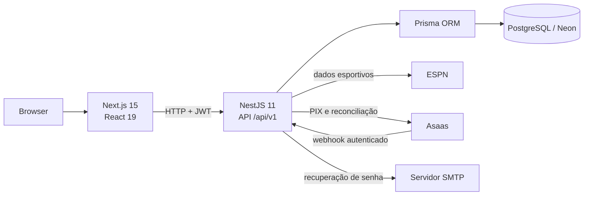
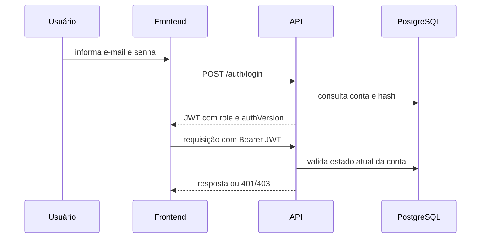
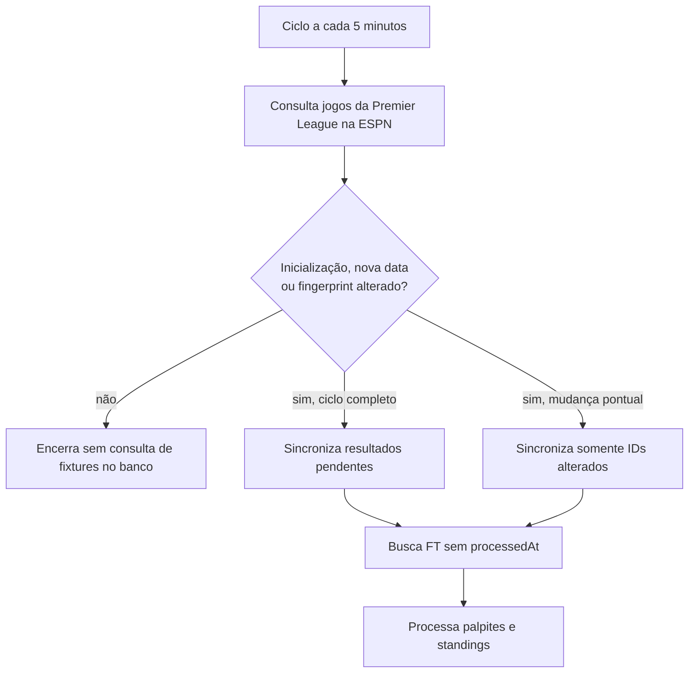

# Arquitetura da aplicação

## Visão geral

O MatchPredict é uma aplicação full-stack formada por frontend Next.js, API NestJS e PostgreSQL acessado pelo Prisma. O backend concentra as regras de negócio e as integrações com ESPN, Asaas e SMTP; o frontend consome a API REST e organiza as experiências pública, autenticada e administrativa.

## Organização do repositório

| Área | Diretório | Responsabilidade |
| --- | --- | --- |
| Frontend | `frontend/` | Interface web, estado cliente e consumo da API |
| Backend | `backend/` | API, autenticação, regras, persistência e integrações |
| Documentação | `docs/` | Visão funcional e técnica do projeto |
| Orquestração | `compose.yaml` | Containers de frontend, backend e Cloudflare Tunnel |

## Frontend

### Tecnologias

- Next.js 15 com App Router e saída standalone;
- React 19 e TypeScript;
- Tailwind CSS;
- TanStack Query para cache e estado assíncrono;
- Axios para HTTP;
- React Hook Form e Zod para formulários;
- Base UI para primitives acessíveis, como o drawer administrativo;
- Lucide React, Sonner e `next-themes`.

### Camadas

- `src/app`: rotas e layouts do App Router;
- `src/features`: componentes e lógica de apresentação por domínio;
- `src/components`: UI e layouts compartilhados;
- `src/services`: funções HTTP agrupadas por domínio;
- `src/hooks`: composição de queries e mutations do TanStack Query;
- `src/providers`: autenticação, tema e `QueryClient`;
- `src/types`: contratos TypeScript consumidos pela interface.

O cliente Axios usa `NEXT_PUBLIC_API_URL` e, na ausência da variável, `http://localhost:3000/api/v1`. Um interceptor anexa o JWT e limpa a sessão em respostas `401` de rotas protegidas.

### Sessão e navegação protegida

- Após login, o JWT é armazenado no `localStorage` e também no cookie `matchpredict_token` com `SameSite=Lax` e validade de sete dias.
- O middleware do Next.js usa a presença do cookie para redirecionar rotas privadas sem sessão e evitar login/cadastro quando há token.
- O `AuthProvider` consulta `/users/me` para obter o estado real da conta.
- A autorização final nunca depende somente do middleware: o backend valida assinatura, usuário, `disabledAt`, `authVersion` e papel.
- O shell do Admin verifica `Role.ADMIN` no cliente para navegação, enquanto `/api/v1/admin` permanece protegido no servidor por guards.

### Áreas da interface

A interface inclui landing page, jogos do dia, competições, autenticação, dashboard, fixtures, palpites, transparência, estatísticas, perfil, participação mensal e Admin.

O layout administrativo compartilhado atende todas as rotas `/admin`: mantém sidebar no desktop e, abaixo de `lg`, combina atalhos horizontais com drawer completo. A configuração das rotas administrativas é centralizada e usada pelas três navegações.

## Backend

### Tecnologias e bootstrap

- NestJS 11 e TypeScript;
- Prisma ORM 6 e PostgreSQL;
- Passport JWT;
- `class-validator` e `class-transformer`;
- NestJS Throttler e Schedule;
- Axios por `@nestjs/axios`;
- Nodemailer;
- Swagger fora de produção.

O bootstrap aplica prefixo `/api/v1`, captura corpo bruto para validação de webhook, configura CORS, proxy confiável opcional, validação global e porta definida pelo ambiente.

### Módulos

| Módulo | Responsabilidade |
| --- | --- |
| `AuthModule` | Cadastro, login, JWT e recuperação de senha |
| `UsersModule` | Perfil e estatísticas pessoais |
| `FootballModule` | Fixtures locais e sincronização esportiva |
| `DailyGamesModule` | Jogos por data diretamente da ESPN, com cache em memória |
| `CompetitionsModule` | Catálogo, temporada, standings esportivos e mata-mata |
| `ParticipationsModule` | Períodos mensais e autorização de participação |
| `PaymentsModule` | PIX, webhook, consulta e reconciliação |
| `PredictionsModule` | Palpites, transparência, pontuação e scheduler |
| `StandingsModule` | Classificação oficial e posição pessoal |
| `AdminModule` | Consultas e ações administrativas auditadas |
| `EmailModule` | Envio de recuperação por SMTP |
| `PrismaModule` | Cliente de acesso ao banco |

## Persistência

O Prisma mapeia o domínio para PostgreSQL. O schema fica em `backend/prisma/schema.prisma` e as migrations em `backend/prisma/migrations`.

Os grupos centrais são:

- identidade: `User` e `AdminAuditLog`;
- participação financeira: `ParticipationPeriod`, `Participation` e `Payment`;
- futebol: `League`, `Season`, `Team`, `Player` e `Fixture`;
- jogo de palpites: `Prediction` e `Standing`;
- modelo reservado: `SyncLog`, atualmente sem gravação funcional.

O banco usa FKs restritivas, unicidades de domínio e índices voltados às consultas de palpites, ranking, pagamentos e Admin. A conexão é fornecida exclusivamente por `DATABASE_URL`.

## Fluxo de autenticação

Contas desativadas são recusadas. A desativação incrementa `authVersion`, fazendo tokens anteriores falharem na próxima requisição protegida. Cadastro público não recebe papel e cria sempre `USER`.

## Fluxo de palpites e classificação

1. O frontend consulta fixtures locais autenticadas.
2. Ao criar ou editar, a API valida proprietário, kickoff, status e `Participation ACTIVE` no período da fixture.
3. A transparência mantém palpites alheios ocultos até o fechamento.
4. Resultados sincronizados levam a fixture a `FT` com placar final.
5. O processador calcula pontos em transação, preenche `processedAt` e recompõe os standings afetados.
6. O recálculo preserva `adjustmentPoints` e materializa `totalPoints`.
7. A classificação ordena os standings pela política compartilhada e deriva `position = index + 1`; o campo legado `Standing.position` não é consultado como posição oficial.

## Integração com a ESPN

Há dois usos complementares:

- `FootballModule` mantém no banco a liga de palpites, temporada, times, jogadores, fixtures e resultados;
- `DailyGamesModule` e `CompetitionsModule` consultam scoreboards, resumos e standings para a experiência ampla de jogos e competições.

O cliente ESPN normaliza URLs, força referências HTTP para HTTPS e deduplica requisições simultâneas idênticas em memória. Jogos do dia possuem cache em memória com TTL adaptado: 30 segundos quando há jogo ao vivo, 60 segundos para o dia atual sem jogo ao vivo, 30 minutos para datas futuras e 6 horas para datas passadas.

Falhas parciais de uma competição não impedem necessariamente a resposta das demais; os metadados informam quantas consultas tiveram sucesso.

## Scheduler e uso do Neon

O scheduler de resultados roda a cada cinco minutos com `waitForCompletion`, mas não começa cada ciclo consultando fixtures no PostgreSQL.

A estratégia usa:

- consulta à ESPN para hoje e datas próximas da competição `eng.1`;
- fingerprint em memória composto por evento, kickoff, status, placar e pênaltis;
- retorno antecipado sem leitura de fixtures quando nada mudou;
- filtro por `apiFixtureId` nos ciclos com mudanças específicas;
- uma tentativa de reconciliação completa ao iniciar o processo e, depois, no máximo uma por data civil em `America/Sao_Paulo`.

Se a consulta ESPN falhar no ciclo reservado à reconciliação completa, o backend ainda tenta reconciliar o estado local. Os fingerprints são memória do processo e são reconstruídos após reinicialização.

Essa estratégia reduz atividade recorrente no Neon quando o estado esportivo permanece estável. Ela não elimina o acesso ao banco quando há mudança, inicialização, nova data ou sincronização manual.

## Participação mensal e Asaas

O `ParticipationsModule` determina períodos mensais em `America/Sao_Paulo`. O `PaymentsModule` injeta o `AsaasPaymentProvider` por uma interface de provedor PIX.

### Criação

1. A API obtém ou cria o período vigente.
2. Reserva ou reutiliza um `Payment PENDING` local em transação serializável.
3. O provider solicita ao Asaas um QR PIX estático de uso único, com valor fixo, expiração e referência externa local.
4. A API persiste referência, payload copia e cola, imagem do QR e expiração.

### Confirmação

O caminho principal é o webhook autenticado `PAYMENT_RECEIVED`. A API valida token, provedor, método, estado, valor, moeda e correlação. Em uma transação serializável, muda o pagamento para `PAID` e cria a `Participation ACTIVE` vinculada.

O caminho de recuperação é a reconciliação pontual iniciada pelo usuário. Ela consulta o Asaas pela referência do QR, valida uma única correspondência e reutiliza a mesma rotina idempotente de confirmação.

Enquanto a página de participação exibe um PIX `PENDING`, o frontend consulta seu status a cada 30 segundos, sem execução em segundo plano, e agenda uma única reconciliação automática após 90 segundos quando a página está visível. O usuário também pode reconciliar manualmente. O backend aplica rate limit e cooldown de dois minutos. Não há scheduler ou job financeiro recorrente no servidor.

## Administração

A API administrativa é protegida por `JwtAuthGuard`, `RolesGuard`, `ThrottlerGuard` e `@Roles(Role.ADMIN)`. Suas consultas são executadas somente quando requisitadas; não existe polling específico do Admin no backend.

O painel fornece dashboard, usuários, detalhe, pagamentos, participações, pendências observacionais e auditoria. Desativação, reativação e exclusão válida usam transações e `AdminAuditLog`. O Admin não oferece mutações financeiras nem promoção de papel.

## Segurança transversal

- validação global de DTOs com rejeição de campos extras;
- throttling global de 60 requisições por minuto e limites menores em operações sensíveis;
- JWT validado contra o estado atual da conta;
- autorização por papel no backend;
- webhook Asaas autenticado com token dedicado e comparação em tempo constante;
- segredos obtidos por variáveis de ambiente;
- CORS configurável por origem;
- Swagger indisponível em produção;
- chamadas externas com timeout e sem redirecionamentos no provider Asaas.

Nomes de configuração relevantes incluem `DATABASE_URL`, `NEXT_PUBLIC_API_URL`, `JWT_SECRET`, `JWT_EXPIRES_IN`, variáveis `ESPN_*`, `ASAAS_API_KEY`, `ASAAS_BASE_URL`, `ASAAS_PIX_ADDRESS_KEY`, `ASAAS_WEBHOOK_TOKEN`, variáveis `SMTP_*`, `EMAIL_FROM`, `FRONTEND_URL`, `CORS_ORIGINS` e `TRUST_PROXY_HOPS`. Valores não devem ser versionados ou incluídos na documentação.

## Containers e exposição

O `compose.yaml` define:

| Serviço | Porta/exposição | Função |
| --- | --- | --- |
| `backend` | host `127.0.0.1:3001` → container `3000` | API NestJS |
| `frontend` | host `3002` → container `3000` | aplicação Next.js |
| `cloudflared` | `network_mode: host` | túnel para os serviços |

Backend e frontend usam Dockerfiles multi-stage baseados em Node.js 20 Alpine e executam como usuário `node`. O backend gera o Prisma Client no build e no estágio de produção; o frontend gera saída standalone e recebe `NEXT_PUBLIC_API_URL` como build arg.

O arquivo de configuração do Cloudflare Tunnel é montado de `./cloudflared`; a documentação não deve registrar domínio, credencial ou token privado.
